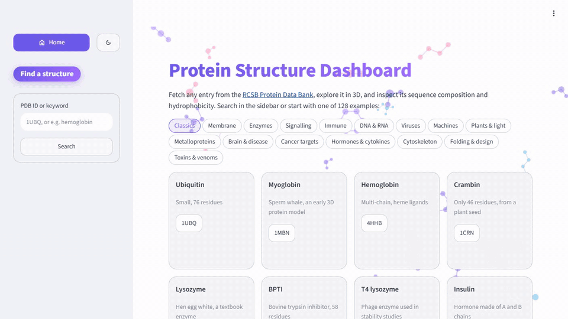
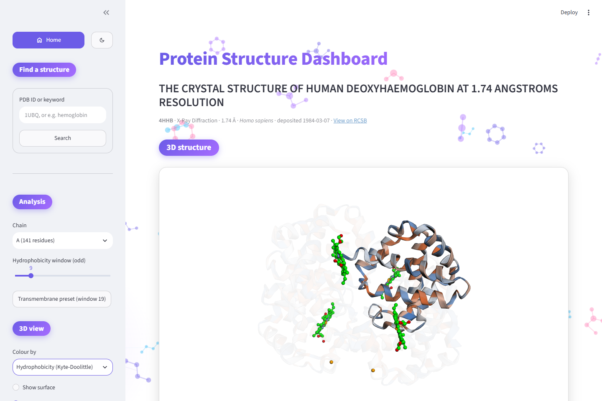
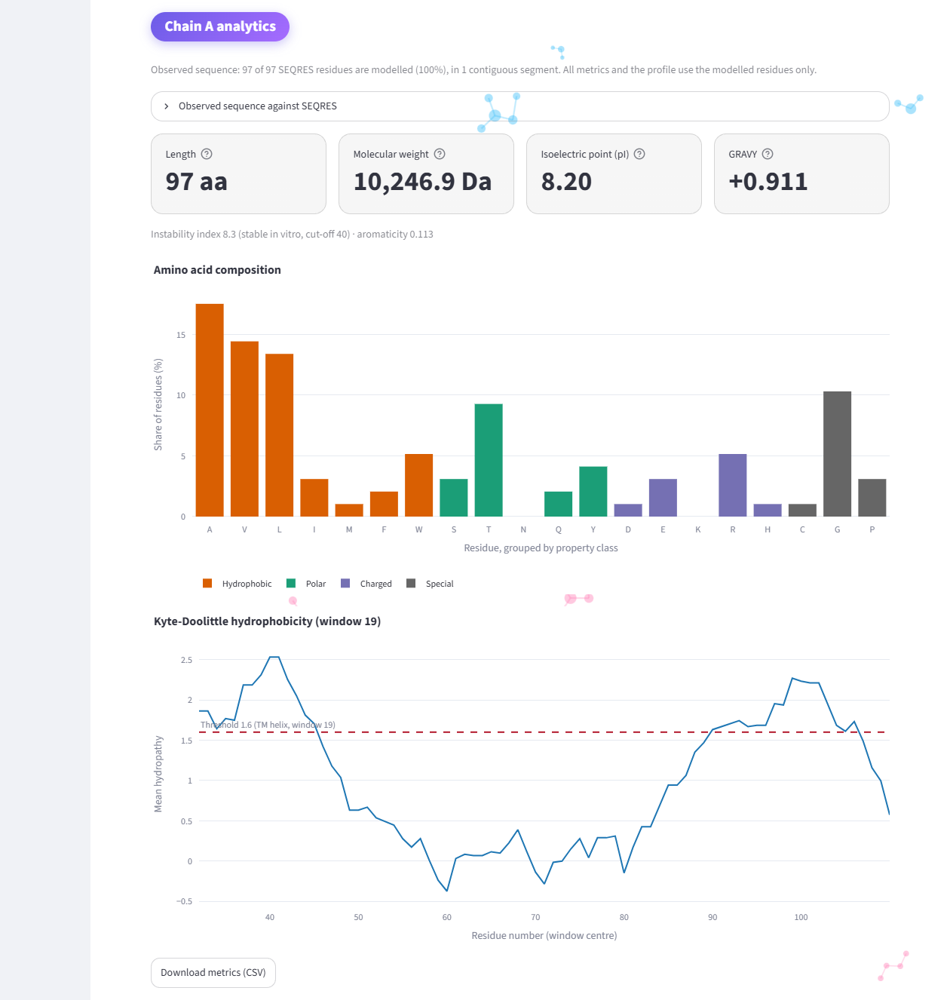
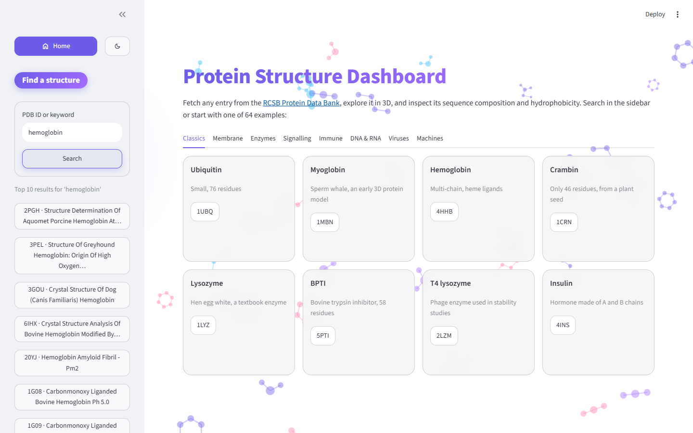
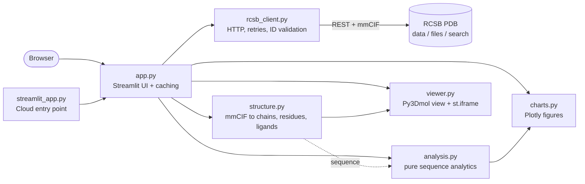

# Protein Structure Dashboard

[](https://protein-structure-dashboard.streamlit.app)

[](https://github.com/aleksandrahodzzik/protein-structure-dashboard/actions/workflows/ci.yml)


A Streamlit dashboard that fetches any entry from the [RCSB Protein Data Bank](https://www.rcsb.org/) through its REST APIs, renders it as an interactive 3D model with Py3Dmol, and analyses each protein chain with Biopython: amino acid composition, molecular weight, isoelectric point, GRAVY and a Kyte-Doolittle hydrophobicity profile, all shown as interactive Plotly charts. The analysis code is plain, pure Python that is tested without a network, and the whole app ships as a small non-root Docker image with linting, type checking, tests and an image build running in GitHub Actions.

## Live demo

**[Open the live demo](https://protein-structure-dashboard.streamlit.app)**

> The demo runs on Streamlit Community Cloud, which puts apps to sleep after a period of inactivity. If you see a "This app has gone to sleep" page, click the wake-up button and give it about 30 seconds.

**[Or run it in your browser, on GitHub Pages](https://aleksandrahodzzik.github.io/protein-structure-dashboard/)**: the same app with no server at all (see [In-browser build](#in-browser-build-github-pages)). It never sleeps, but it takes 30-45 s to start while Python loads into the page.



## Features

- **128 curated examples in 16 categories** (classics, membrane, enzymes, signalling, immune, DNA and RNA, viruses, machines, plants and light, metalloproteins, brain and disease, cancer targets, hormones, cytoskeleton, folding and design, toxins), picked from a pill selector and each checked against the live RCSB API. Three of them are large enough to trigger the backbone-only mode on purpose.
- **Search by PDB ID or keyword.** An ID such as `1UBQ` opens the entry directly. Free text such as `hemoglobin` runs an RCSB full-text search and lists the top hits. The selected entry is kept in the URL (`?pdb=1UBQ`), so every view is linkable.
- **Interactive 3D viewer.** Cartoon rendering with three colouring modes: by chain, N→C spectrum, and per-residue Kyte-Doolittle hydrophobicity. It also offers an optional solvent-accessible surface, ligands as sticks, and dimming of the chains you are not analysing.
- **Per-chain analytics.** Length, average molecular weight, isoelectric point, GRAVY, instability index and aromaticity, plus a composition bar chart grouped by property class (hydrophobic, polar, charged, special).
- **Hydrophobicity profile.** A sliding-window Kyte-Doolittle plot with an adjustable odd window (3-39) and a one-click transmembrane preset (window 19, threshold 1.6). Hover shows the residue number and amino acid. No window ever spans a gap: the line breaks wherever residues are missing from the density (or non-standard), and residues that are in SEQRES but not modelled are shaded grey.
- **Observed sequence against SEQRES.** Each chain says how many residues of the deposited (SEQRES) sequence are modelled, lists the missing stretches in the structure's own numbering, flags modelled residues that differ from SEQRES or have no SEQRES position, and shows both sequences aligned.
- **CSV export** of the metrics for the selected chain.
- **Interactive background.** Small ball-and-stick molecules drift behind the page, are pushed away by the mouse pointer, and faint bonds reach from the pointer to nearby molecules. It is one canvas drawn by a short script (`background.py`) with no network access, and it is switched off for visitors who ask their system for reduced motion.
- **Navigation and theme.** A menu at the top of the sidebar has a Home button (back to the example gallery) and a light/dark switch. The 3D viewer keeps a white canvas in both themes.
- **Sensible handling of awkward entries.** Modified residues (e.g. selenomethionine), chains with gaps in the electron density, NMR ensembles (first model only), non-protein entries, and very large assemblies (backbone-only rendering above 50,000 atoms) are all handled and explained in the UI instead of crashing.





## Architecture

The UI layer is thin. Every function that does real work is pure or isolated behind a small interface, which is what makes it unit-testable without a browser or a network.



| Module | Responsibility | Touches network / Streamlit? |
| --- | --- | --- |
| `rcsb_client.py` | Fetch entry metadata, mmCIF files and search results. Retries with backoff. | Network only |
| `structure.py` | Parse mmCIF with Biopython into chains, observed sequences, gaps, SEQRES and ligands. Compare observed with SEQRES. Trim files for the viewer. | No |
| `analysis.py` | Composition, MW, pI, GRAVY, gap-aware Kyte-Doolittle windows. | No |
| `charts.py` | Turn analysis results into Plotly figures. | No |
| `viewer.py` | Build a Py3Dmol scene and embed it. | Streamlit only in one wrapper function |
| `app.py` | Layout, widgets, caching, error messages. | Streamlit |

## Quickstart

### Local

Requirements: Python 3.12 and [uv](https://docs.astral.sh/uv/getting-started/installation/).

```bash
git clone https://github.com/aleksandrahodzzik/protein-structure-dashboard.git
cd protein-structure-dashboard
uv sync
make run          # or: uv run streamlit run streamlit_app.py
```

Open <http://localhost:8501> and try `1UBQ`.

Useful targets: `make test`, `make lint`, `make format`, `make requirements` (regenerates `requirements.txt` for Streamlit Cloud).

> `make` is not installed on Windows by default. Run the command shown after `or:` in each target (see the `Makefile`), or use WSL.

### Docker

```bash
make docker-build
make docker-run   # then open http://localhost:8501
```

Or without `make`:

```bash
docker build -t protein-structure-dashboard .
docker run --rm -p 8501:8501 protein-structure-dashboard
```

The image is multi-stage (dependencies are installed with uv in a builder stage), runs as a non-root user, and has a `HEALTHCHECK` on Streamlit's `/_stcore/health` endpoint. It is not tiny (about 850 MB), mostly because of the scientific Python dependencies.

### In-browser build (GitHub Pages)

`scripts/build_pages.py` turns the app into one static `index.html` that runs it with [stlite](https://github.com/whitphx/stlite), i.e. Streamlit on Pyodide in a web worker. The page embeds the app's sources, its `.streamlit/config.toml` and its requirements, so it cannot drift from the code it was built from. The `Pages` workflow (`.github/workflows/pages.yml`) builds and publishes it on every push to `main`.

```bash
python scripts/build_pages.py        # writes _site/index.html (standard library only)
python -m http.server -d _site 8000  # then open http://localhost:8000
```

No code changes were needed, because RCSB's APIs answer the browser directly (`Access-Control-Allow-Origin: *`) and stlite patches `requests` to use the browser's own HTTP. The differences from the server version:

- Streamlit is the version that stlite bundles (1.65 with stlite 1.12.0), not the one in `uv.lock`. Biopython and `requests` come from Pyodide's own distribution, while plotly and py3Dmol are pinned to `uv.lock`.
- The first visit downloads about 40 MB (Pyodide, Streamlit and the app's packages), and the app takes 30-45 s to appear. Later visits take a little less, since the downloads then come from the browser cache, but starting Python still takes most of that time.
- The browser does not let a page set `User-Agent`, so RCSB sees the browser's own. `time.sleep` does nothing in Pyodide, so retries happen without the backoff.
- Each visitor runs their own copy, so the `st.cache_data` cache lives only as long as the tab.

## Design decisions

**Thin UI over pure analysis.** `analysis.py` takes a string and returns numbers; it imports neither Streamlit nor `requests`. The same functions can therefore be tested with a known protein and reused in a script or a notebook. `app.py` only wires widgets to those functions.

**Caching and rate limits.** RCSB is a free public service, so the app is polite to it. Entry metadata, mmCIF text, parsed structures and search results are cached with `st.cache_data` for 24 hours (PDB entries are effectively immutable, so stale data is not a real risk). The client sends a descriptive `User-Agent`, uses connect/read timeouts, and retries only what is worth retrying: connection errors, timeouts, HTTP 429 and 5xx. It honours `Retry-After` (capped at 10 s) and otherwise backs off exponentially. A 404 is not retried; it becomes a clear "entry not found" message. Retry sleeping is injectable, so the tests do not actually wait.

**Why `st.iframe` and not `stmol`.** `stmol` is a thin wrapper around Py3Dmol that adds a dependency and tends to lag behind Streamlit releases. Py3Dmol already produces a self-contained HTML page via its public `view.write_html()`, and Streamlit embeds it with `st.iframe`, the supported replacement for the deprecated `streamlit.components.v1.html`. `st.iframe` runs that HTML with full JavaScript access, so it must never receive user input; here the page is built by our own code from RCSB coordinates. The entire embedding lives in one function, `viewer.show_view`.

**Observed sequence versus SEQRES.** The chain sequence the dashboard analyses is the *observed* one: the residues that actually have coordinates in the structure. The deposited (SEQRES) sequence can be longer, because flexible loops, tags and termini are often missing from the electron density. For example, chain A of the SARS-CoV-2 spike in 6VXX has 972 modelled residues in 12 segments, out of 1,281 in the deposited sequence. Analysing the observed sequence keeps the 3D view, the sequence and the plots consistent with one another (residue numbers in the hover text match the structure). The UI then shows exactly where the two differ. It reads the SEQRES-to-structure mapping (`_pdbx_poly_seq_scheme`) from the mmCIF file it has already downloaded, so there is no extra request. It lines the modelled residues up with it by author residue number, and lists the stretches that are not modelled (in 6VXX: −18 to 26, 70–79, 144–164 and so on). It also lists any modelled residue whose type differs from SEQRES, and any that has no SEQRES position. Known modified residues are mapped to their parent amino acid (for example selenomethionine to methionine) and unknown ones become `X`, so positions in the sequence never shift.

**Gaps break the hydrophobicity profile.** A sliding window that runs across a gap averages residues that are not neighbours in the chain. For example, the last residues before a disordered loop get averaged with the first residues after it, which can invent a hydrophobic stretch or hide one. So the profile is computed separately for each gap-free stretch of standard residues. Each stretch of length *n* gives *n − w + 1* points, stretches shorter than the window give none, and the plotted line is broken between stretches. Gaps are detected from the coordinates rather than from the numbering. Two consecutive residues are neighbours if their peptide bond C–N is under 1.8 Å, or, in models that have only Cα atoms, if Cα–Cα is under 4.3 Å. This also catches loops that the depositors left out of SEQRES altogether, as in bacteriorhodopsin 1C3W, where residues 157–161 are missing from both. A non-standard residue (`X`) breaks a window too, because it has no Kyte-Doolittle value. The window slider is capped at the longest gap-free stretch, so every offered window produces a profile.

**Server-side file trimming for the viewer.** Large mmCIF files are expensive for the browser. Before sending a structure to the viewer, `structure.trim_mmcif` keeps only the first model and the atoms needed for a cartoon (plus the secondary-structure records), and above 50,000 atoms the viewer drops the surface, ligands and chain dimming.

## Testing

```bash
make test          # pytest with coverage, no network required
make lint          # ruff check, ruff format --check, mypy
```

- 169 tests, about 98% line coverage, none of which touch the network.
- `analysis`: ubiquitin molecular weight (≈ 8564.7 Da), composition sums to 100%, Kyte-Doolittle profile length is `L - w + 1` and matches Biopython on a gap-free chain, no window spans a gap or an `X`, invalid characters are handled, window validation.
- `structure`: a real 1UBQ mmCIF fixture (`tests/data/1UBQ.cif`: one chain, 76 residues, expected sequence, SEQRES fully modelled) and synthetic files for modified residues, gaps, Cα-only models, ligands, water, multiple models, and SEQRES with missing, mismatched, heterogeneous and unmatched residues.
- `rcsb_client`: HTTP mocked with [`responses`](https://github.com/getsentry/responses): success, 404, 429 followed by success, timeouts, retry exhaustion, invalid IDs.
- `app`: Streamlit's `AppTest` smoke tests drive the real UI against a fake client, including a synthetic gapped entry (SEQRES summary, warnings, alignment, slider cap) and the one-off theme script.
- `build_pages`: every module of the package is embedded in the Pages build, the requirements leave Streamlit to stlite, and no embedded source can close the page's JSON `<script>` block early.
- CI (`.github/workflows/ci.yml`) runs lint → tests with coverage → Docker build and container health check, and verifies that `requirements.txt` is in sync with `uv.lock`. A separate workflow (`pages.yml`) publishes the in-browser build.

The screenshots in this README are generated by `scripts/screenshots.py` (Playwright, headless Chromium) against a running app:

```bash
uv sync --group screenshots && uv run playwright install chromium
uv run streamlit run streamlit_app.py --server.port 8599 &
uv run python scripts/screenshots.py --url http://localhost:8599
```

The demo GIF at the top is recorded the same way by `scripts/demo_gif.py`, here against the live demo. The script warms the app up first, records a Playwright video, and converts it with the ffmpeg bundled in `imageio-ffmpeg`. On Community Cloud the app itself is served under `/~/+/`:

```bash
uv run python scripts/demo_gif.py --url https://protein-structure-dashboard.streamlit.app/~/+/
```

## Limitations and next steps

- **Live API dependency.** If RCSB is down or slow, the app shows an error; there is no persistent cache or offline mode beyond Streamlit's in-memory cache.
- **Observed sequences only.** The metrics describe the modelled residues. SEQRES is shown and compared with them, but not analysed itself, so for example the molecular weight is not that of the full deposited chain. Modified residues are analysed as their parent amino acid (so the mass of selenomethionine is that of methionine), and unknown residues become `X`, are excluded from the metrics, and are reported in the UI.
- **Microheterogeneity.** A few entries deposit two residue types at one position (crambin 1EJG, for example). Biopython's mmCIF parser rejects those files, so the app shows a parse error for them instead of a structure.
- **Average molecular weight only** (monoisotopic mass is implemented in the analysis function but not exposed in the UI), and only for the protein chains; nucleic acid chains are skipped.
- **Very large assemblies** (e.g. ribosomes) can take 20 s or more to download and render, and are drawn as backbone only.
- **The theme switch is a workaround.** Streamlit (checked up to 1.66.1, the latest release) has no supported way to change the theme: `st.context.theme` is read-only, and theme options cannot be set while the app runs. So the sidebar button runs a tiny script that presses the item in Streamlit's own menu. `st.context.theme` only updates on the next run, so the button keeps the theme it asked for in session state and picks its icon from that, and it adopts whatever the browser reports next, including a switch made in the built-in menu. (An earlier version also pressed the menu's "Rerun", which the menu of a deployed app does not have, so on the live demo the icon lagged one click behind.) The script goes through the supported `st.html(..., unsafe_allow_javascript=True)`, not the deprecated `components.html`. It still relies on the menu's internal element IDs, so it is tested against the pinned Streamlit version and does nothing, rather than breaking, if they change. The built-in menu (⋮ → Light / Dark) always works.
- **Classic four-character PDB IDs only**; the extended `pdb_` format is not supported.
- **Docker image is about 850 MB**; a smaller image would need dependency pruning.
- **Next steps:** offer metrics for the full SEQRES sequence next to the observed ones, compare chains side by side, add secondary-structure and B-factor views, and precompute metrics for popular entries.

## License

[MIT](LICENSE)
