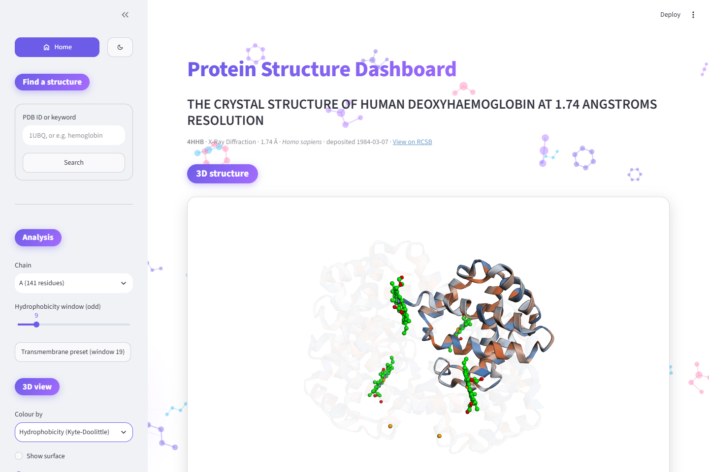
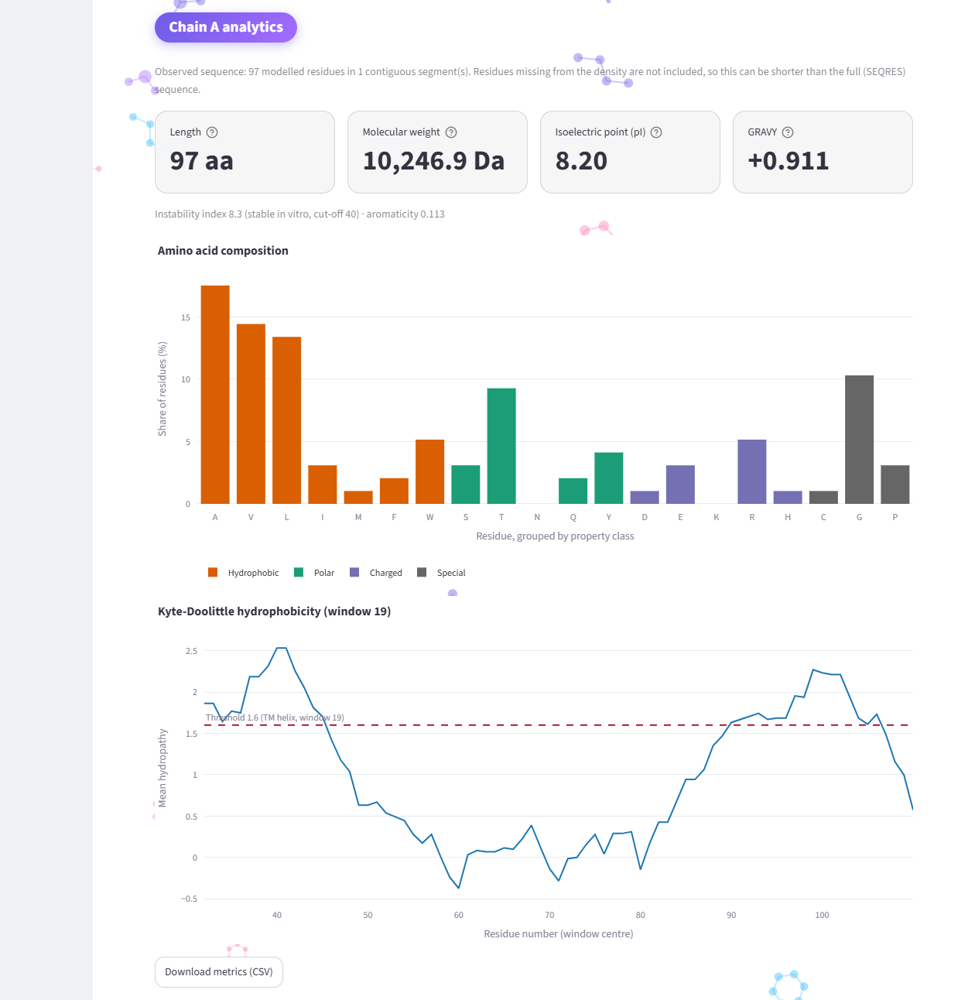
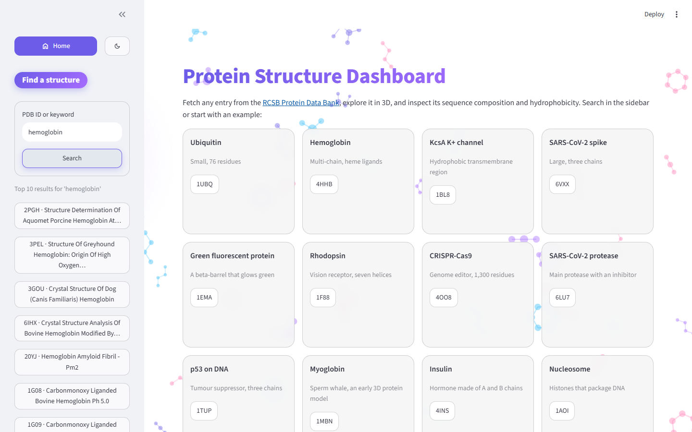
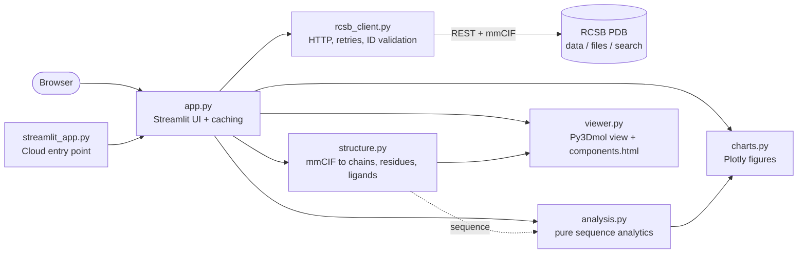

# Protein Structure Dashboard

[](https://github.com/aleksandrahodzzik/protein-structure-dashboard/actions/workflows/ci.yml)


A Streamlit dashboard that fetches any entry from the [RCSB Protein Data Bank](https://www.rcsb.org/) through its REST APIs, renders it as an interactive 3D model with Py3Dmol, and analyses each protein chain with Biopython: amino acid composition, molecular weight, isoelectric point, GRAVY and a Kyte-Doolittle hydrophobicity profile, all shown as interactive Plotly charts. The analysis code is plain, pure Python that is tested without a network, and the whole app ships as a small non-root Docker image with linting, type checking, tests and an image build running in GitHub Actions.

## Live demo

**[Open the live demo](https://protein-structure-dashboard.streamlit.app)**

> The demo runs on Streamlit Community Cloud, which puts apps to sleep after a period of inactivity. If you see a "This app has gone to sleep" page, click the wake-up button and give it about 30 seconds.



## Features

- **Search by PDB ID or keyword.** An ID such as `1UBQ` opens the entry directly. Free text such as `hemoglobin` runs an RCSB full-text search and lists the top hits. The selected entry is kept in the URL (`?pdb=1UBQ`), so every view is linkable.
- **Interactive 3D viewer.** Cartoon rendering with three colouring modes: by chain, N→C spectrum, and per-residue Kyte-Doolittle hydrophobicity. It also offers an optional solvent-accessible surface, ligands as sticks, and dimming of the chains you are not analysing.
- **Per-chain analytics.** Length, average molecular weight, isoelectric point, GRAVY, instability index and aromaticity, plus a composition bar chart grouped by property class (hydrophobic, polar, charged, special).
- **Hydrophobicity profile.** A sliding-window Kyte-Doolittle plot with an adjustable odd window (3-39) and a one-click transmembrane preset (window 19, threshold 1.6). Hover shows the residue number and amino acid.
- **CSV export** of the metrics for the selected chain.
- **Interactive background.** Small ball-and-stick molecules drift behind the page, are pushed away by the mouse pointer, and faint bonds reach from the pointer to nearby molecules. It is one canvas drawn by a short script (`background.py`) with no network access, and it is switched off for visitors who ask their system for reduced motion.
- **Navigation and theme.** A menu at the top of the sidebar has a Home button (back to the 12-example gallery) and a light/dark switch. The 3D viewer's background follows the theme.
- **Sensible handling of awkward entries.** Modified residues (e.g. selenomethionine), chains with gaps in the electron density, NMR ensembles (first model only), non-protein entries, and very large assemblies (backbone-only rendering above 50,000 atoms) are all handled and explained in the UI instead of crashing.





## Architecture

The UI layer is thin. Every function that does real work is pure or isolated behind a small interface, which is what makes it unit-testable without a browser or a network.



| Module | Responsibility | Touches network / Streamlit? |
| --- | --- | --- |
| `rcsb_client.py` | Fetch entry metadata, mmCIF files and search results. Retries with backoff. | Network only |
| `structure.py` | Parse mmCIF with Biopython into chains, observed sequences and ligands. Trim files for the viewer. | No |
| `analysis.py` | Composition, MW, pI, GRAVY, Kyte-Doolittle windows. | No |
| `charts.py` | Turn analysis results into Plotly figures. | No |
| `viewer.py` | Build a Py3Dmol scene and embed it. | Streamlit only in one wrapper function |
| `app.py` | Layout, widgets, caching, error messages. | Streamlit |

## Quickstart

### Local

Requirements: Python 3.12 and [uv](https://docs.astral.sh/uv/getting-started/installation/).

```bash
git clone https://github.com/aleksandrahodzzik/protein-structure-dashboard.git
cd protein-structure-dashboard
uv sync
make run          # or: uv run streamlit run streamlit_app.py
```

Open <http://localhost:8501> and try `1UBQ`.

Useful targets: `make test`, `make lint`, `make format`, `make requirements` (regenerates `requirements.txt` for Streamlit Cloud).

> `make` is not installed on Windows by default. Run the command shown after `or:` in each target (see the `Makefile`), or use WSL.

### Docker

```bash
make docker-build
make docker-run   # then open http://localhost:8501
```

Or without `make`:

```bash
docker build -t protein-structure-dashboard .
docker run --rm -p 8501:8501 protein-structure-dashboard
```

The image is multi-stage (dependencies are installed with uv in a builder stage), runs as a non-root user, and has a `HEALTHCHECK` on Streamlit's `/_stcore/health` endpoint. It is not tiny (about 850 MB), mostly because of the scientific Python dependencies.

## Design decisions

**Thin UI over pure analysis.** `analysis.py` takes a string and returns numbers; it imports neither Streamlit nor `requests`. The same functions can therefore be tested with a known protein and reused in a script or a notebook. `app.py` only wires widgets to those functions.

**Caching and rate limits.** RCSB is a free public service, so the app is polite to it. Entry metadata, mmCIF text, parsed structures and search results are cached with `st.cache_data` for 24 hours (PDB entries are effectively immutable, so stale data is not a real risk). The client sends a descriptive `User-Agent`, uses connect/read timeouts, and retries only what is worth retrying: connection errors, timeouts, HTTP 429 and 5xx. It honours `Retry-After` (capped at 10 s) and otherwise backs off exponentially. A 404 is not retried; it becomes a clear "entry not found" message. Retry sleeping is injectable, so the tests do not actually wait.

**Why `components.html` and not `stmol`.** `stmol` is a thin wrapper around Py3Dmol that adds a dependency and tends to lag behind Streamlit releases. Py3Dmol already produces a self-contained HTML page via `view._make_html()`, and Streamlit can embed it with `streamlit.components.v1.html`. The entire embedding lives in one function, `viewer.show_view`, so swapping the mechanism later is a one-function change. Note that recent Streamlit versions print a deprecation notice for `components.html` in favour of `st.iframe`. It still works, and that one wrapper is where the migration would happen.

**Observed sequence versus SEQRES.** The chain sequence the dashboard analyses is the *observed* one: the residues that actually have coordinates in the structure. The deposited full-length (SEQRES) sequence can be longer, because flexible loops, tags and termini are often missing from the electron density. For example, chain A of the SARS-CoV-2 spike in 6VXX has 972 modelled residues in 12 segments, while the full chain is 1,273 residues. Analysing the observed sequence keeps the 3D view, the sequence and the plots consistent with one another (residue numbers in the hover text match the structure), and the UI says explicitly when the observed sequence is shorter than expected. Known modified residues are mapped to their parent amino acid (for example selenomethionine to methionine) and unknown ones become `X`, so positions in the sequence never shift.

**Server-side file trimming for the viewer.** Large mmCIF files are expensive for the browser. Before sending a structure to the viewer, `structure.trim_mmcif` keeps only the first model and the atoms needed for a cartoon (plus the secondary-structure records), and above 50,000 atoms the viewer drops the surface, ligands and chain dimming.

## Testing

```bash
make test          # pytest with coverage, no network required
make lint          # ruff check, ruff format --check, mypy
```

- 129 tests, about 97% line coverage, none of which touch the network.
- `analysis`: ubiquitin molecular weight (≈ 8564.7 Da), composition sums to 100%, Kyte-Doolittle profile length is `L - w + 1`, invalid characters are handled, window validation.
- `structure`: a real 1UBQ mmCIF fixture (`tests/data/1UBQ.cif`: one chain, 76 residues, expected sequence) and synthetic files for modified residues, gaps, ligands, water and multiple models.
- `rcsb_client`: HTTP mocked with [`responses`](https://github.com/getsentry/responses): success, 404, 429 followed by success, timeouts, retry exhaustion, invalid IDs.
- `app`: Streamlit's `AppTest` smoke tests drive the real UI against a fake client.
- CI (`.github/workflows/ci.yml`) runs lint → tests with coverage → Docker build and container health check, and verifies that `requirements.txt` is in sync with `uv.lock`.

The screenshots in this README are generated by `scripts/screenshots.py` (Playwright, headless Chromium) against a running app:

```bash
uv sync --group screenshots && uv run playwright install chromium
uv run streamlit run streamlit_app.py --server.port 8599 &
uv run python scripts/screenshots.py --url http://localhost:8599
```

## Limitations and next steps

- **Live API dependency.** If RCSB is down or slow, the app shows an error; there is no persistent cache or offline mode beyond Streamlit's in-memory cache.
- **Observed sequences only.** The SEQRES sequence is not analysed, and Kyte-Doolittle windows slide across gaps in the observed sequence as if the residues were adjacent. Modified residues are analysed as their parent amino acid (so the mass of selenomethionine is that of methionine), and unknown residues become `X`, are excluded from the metrics, and are reported in the UI.
- **Average molecular weight only** (monoisotopic mass is implemented in the analysis function but not exposed in the UI), and only for the protein chains; nucleic acid chains are skipped.
- **Very large assemblies** (e.g. ribosomes) can take 20 s or more to download and render, and are drawn as backbone only.
- **The theme switch is a workaround.** Streamlit has no Python API to change the theme, so the sidebar button runs a tiny script that presses the item in Streamlit's own menu (and its "Rerun", because `st.context.theme` only updates on the next run). It relies on that menu's internal element IDs, so it is tested against the pinned Streamlit version and does nothing, rather than breaking, if they change. The built-in menu (⋮ → Light / Dark) always works.
- **Classic four-character PDB IDs only**; the extended `pdb_` format is not supported.
- **Docker image is about 850 MB**; a smaller image would need dependency pruning.
- **Next steps:** analyse SEQRES via the polymer entity API, compare chains side by side, add secondary-structure and B-factor views, precompute metrics for popular entries, and move to `st.iframe` once it is the stable embedding mechanism.

## License

[MIT](LICENSE)
